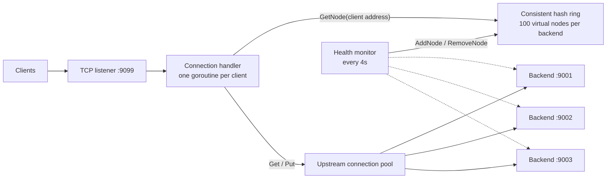
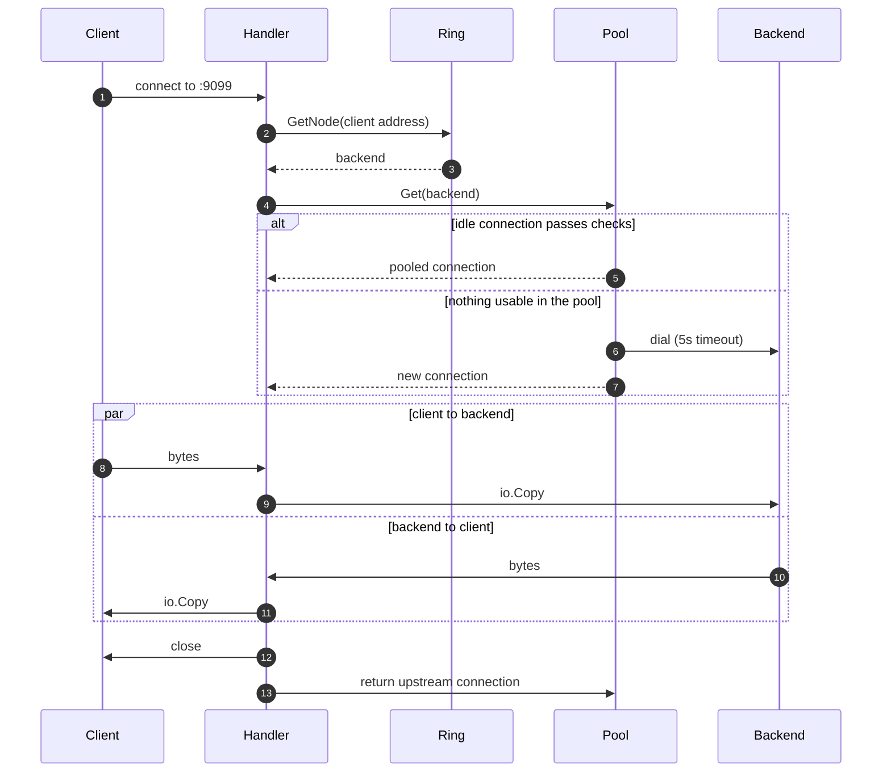
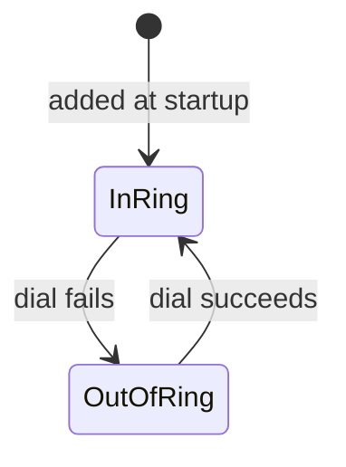
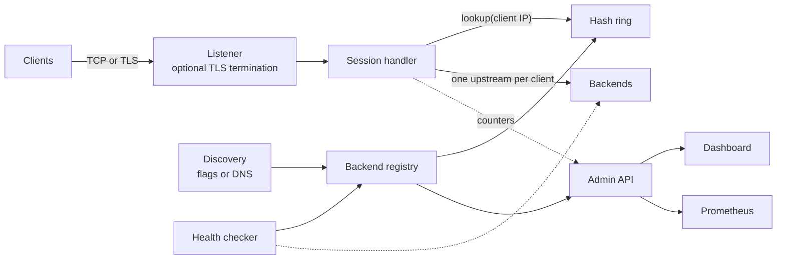
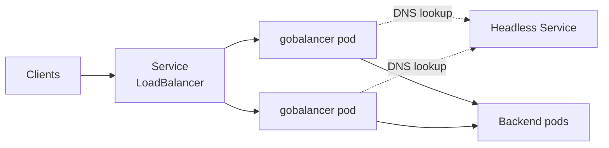

# GoBalancer Design Doc

**Author:** Harsh Mittal ([@harshmittal09](https://github.com/harshmittal09))
**Status:** Draft, updated as work lands
**Last updated:** 2026-10-27

This doc covers how GoBalancer is built today, what the benchmarks show, the problems I've found, and what I plan to build next. For setup and usage, see the [README](README.md).

## 1. Overview

GoBalancer is a Layer 4 TCP load balancer written in Go with only the standard library. It accepts client connections, picks a backend using a consistent hash ring, and copies bytes in both directions without looking at them. A background health checker removes dead backends from the ring and adds them back when they recover.

I built it to understand what tools like HAProxy (TCP mode) and NGINX `stream` do internally: how a backend is chosen, how failures are detected, and what happens to clients when the backend set changes.

## 2. Goals and non-goals

**Goals**

- Route each client connection to a healthy backend.
- When a backend is added or removed, move only the clients that belonged to it.
- Stop sending traffic to a dead backend automatically, and resume when it comes back.
- Keep per-connection overhead low in both memory and latency.
- Keep every performance number reproducible from scripts in this repo.

**Non-goals**

- HTTP-aware features such as path routing, header rewrites or per-request retries.
- High availability of the balancer itself.
- UDP.

## 3. Architecture

**Status: Implemented**

| Package | Responsibility |
|---|---|
| `ring` | Consistent hash ring with virtual nodes. Safe for concurrent use |
| `proxy` (`tcp.go`) | Accepts clients and copies data between client and backend |
| `proxy` (`pool.go`) | Keeps idle upstream connections per backend |
| `monitor` | Health-checks every backend on a timer and updates the ring |
| `main` | Wires everything together and handles `SIGINT` / `SIGTERM` |

## 4. Design details

### 4.1 Connection flow

Each accepted connection gets its own goroutine. That goroutine looks up a backend, gets an upstream connection, and starts two copies, one per direction. When either copy finishes, it sets an immediate deadline on the other connection so the second copy unblocks and the session can be cleaned up.

### 4.2 Consistent hashing

With plain `hash(client) % N`, adding or removing one backend reshuffles almost every client. A consistent hash ring avoids that: each backend owns a slice of the hash space, so a change only affects the clients in the slice that changed hands.

**How the ring works.**

- Each backend is hashed onto the ring 100 times (`addr#1` to `addr#100`) with 32-bit FNV-1a. Spreading a backend over many points evens out how much of the ring it owns, and means a failed backend's traffic is shared across all the others instead of landing on one neighbour.
- The ring is a sorted `[]uint32` of hashes plus a map from hash to backend address, protected by a `sync.RWMutex`.
- A lookup hashes the client address and binary-searches for the first point at or after it, wrapping to the start if needed. Lookups only take a read lock, so they run in parallel.
- Adding a backend inserts into the sorted slice, which is `O(n)`. That's fine here: backends change rarely and lookups happen on every connection.

The remapping behaviour is covered by tests in `ring/ring_test.go`. Removing a backend moves only that backend's clients, adding one moves clients only onto the new backend, and removing then re-adding a backend restores every original assignment.

### 4.3 Health checks

Every 4 seconds the monitor tries to open a TCP connection to each backend, with a 2 second timeout. Success calls `AddNode` and failure calls `RemoveNode`. Both are idempotent, so calling them on every tick is safe.

Because the ring is consistent, a backend that recovers takes back exactly the clients it had before.

### 4.4 Upstream connection pool

Each backend has a buffered channel that holds up to 500 idle connections. Before reusing one, the pool checks two things:

- **Age.** Connections idle for more than 90 s are closed.
- **Liveness.** The pool does a read with a 50 ms deadline. A timeout means the connection is open with nothing waiting on it, so it is reused. Data or EOF means it is discarded.

When nothing usable is left, the pool dials a new connection.

This turned out to be the weakest part of the design. Section 6 explains why, and section 7.1 replaces it.

### 4.5 Shutdown

On `SIGINT` or `SIGTERM`, GoBalancer:

1. Stops the monitor.
2. Closes the listener.
3. Waits for open sessions to finish.
4. Closes all pooled connections.

## 5. Metrics

**Test machine.** All numbers below were measured on a 1 vCPU, 4 GB Linux VM, with the load generator, the balancer and three backends sharing that one core over loopback. Treat them as lower bounds.

**Where to find them.** Full results are in [`bench/results/2026-10-27-sandbox.md`](bench/results/2026-10-27-sandbox.md), and `bench/run.sh` reproduces them on any machine.

| Area | Result |
|---|---|
| Ring lookup | 99 ns with 3 backends, 184 ns with 50; zero allocations |
| Throughput | 6.9 Gbit/s through the balancer (1 stream and 8 streams), 2 GiB per run |
| Persistent connections | 38,800 requests/s across 100 connections; p50 2.35 ms, p99 6.01 ms |
| Concurrent connections | 3,000 held open with all 3,000 still working after 15 s idle; about 18 KiB of memory each |
| Soak | 100,000 sessions, 0 failures, 0 mismatched replies, 3,640 sessions/s |
| Failover | A killed backend was removed 3 s after it died (worst case about 6 s with a 4 s check interval). Only its own clients saw errors. It rejoined about 1 s after restart |
| New connection per request | p50 about 51 ms at every concurrency level (see below) |

**Why new connections are slow.** Opening a new connection per request is slow because of the pool. Every reused upstream connection waits for the 50 ms liveness probe to time out. With the pool removed in a quick experiment, p50 dropped from 50.8 ms to 0.3 ms at concurrency 1, and throughput at concurrency 100 went from about 1.8k to about 5.2k sessions/s.

**File descriptors and memory.** On Linux, `io.Copy` between two TCP sockets uses `splice`, which keeps data out of user space. That is why throughput is high and memory per connection is low. The cost is a pipe pair per direction, so each connection uses 6 file descriptors instead of 2. With a typical Linux default of `ulimit -n 1024`, that caps the balancer at roughly 170 connections, so the file limit needs raising in any real deployment.

## 6. Known issues

All of these were reproduced with running code.

| # | Issue | Effect |
|---|---|---|
| 1 | Pooled upstream connections are reused by different clients | A late response for one client was delivered to the next client. Protocols where the server speaks first (a greeting on connect) break for every client after the first |
| 2 | 50 ms liveness probe on every pooled reuse | Adds about 50 ms to every new connection (section 5) |
| 3 | Half-close is not handled | When a client closes its write side, the upstream is cut right away. 0 of 20 such clients got their response |
| 4 | Routing key includes the client's source port | The same client lands on different backends across connections, so there is no stickiness |
| 5 | Uneven load across backends | FNV-1a clusters virtual nodes. The busiest backend got 2 to 3 times the load of the quietest |
| 6 | No retry when a backend dial fails | Clients mapped to a dead backend are dropped until the next health check, which is the 3 s window in the failover test |
| 7 | Shutdown can hang | Waits for every open connection with no time limit. One idle client blocks it indefinitely |
| 8 | Startup and limit errors are not handled well | A failed bind is logged without the error and the process keeps running. When file descriptors run out, the accept loop retries with no backoff |
| 9 | Config is hardcoded | Backends and ports are constants, so it can't run in Docker or Kubernetes without code changes |

## 7. Future enhancements

**Status: Planned**

The planned architecture adds TLS on the way in and a small control plane with an admin API, a dashboard and metrics:

### 7.1 Data plane fixes

**One upstream connection per client.** Drop the pool. At Layer 4 the balancer can't tell where one request ends, so reusing a connection across clients is never safe. This fixes issues 1 and 2.

**Retry the next backend.** If a dial fails, try the next backend clockwise on the ring before giving up. This fixes issue 6.

**Proper half-close.** When one side finishes sending, call `CloseWrite` on the other side instead of cutting both. This fixes issue 3.

**Hash on client IP.** This gives real stickiness. A flag will turn it off for clients behind large NATs, where many users share one IP. Fixes issue 4.

**Better hash spread.** Pass the FNV-1a output through a mixing step (murmur3's `fmix32`) and raise the default to 500 virtual nodes. In testing this cut the load spread from 29 to 42% CV down to 4 to 5%. Fixes issue 5.

**Limits and timeouts.**
- A maximum session count.
- Backoff on accept errors.
- A shutdown deadline (default 30 s), with leftover connections force-closed.
- Idle timeouts, done in a way that keeps the `splice` fast path for plain TCP.

These fix issues 7 and 8.

**Health check thresholds.** A backend has to fail a few checks in a row before it is removed, and pass a few before it is added back. Every backend also gets one check before the listener starts.

### 7.2 TLS with the local CA

`gen_certs.sh` already creates a local CA and a server certificate for `localhost` and `127.0.0.1`, but the proxy doesn't use them yet. The plan:

1. **Wrap the listener.** Load the key pair with `tls.LoadX509KeyPair` and wrap the listener with `tls.NewListener`. Both are enabled by `--tls-cert` and `--tls-key`, and plain TCP stays the default.
2. **Fix the certificate.** Add `extendedKeyUsage = serverAuth`, which macOS requires, and drop key usages a TLS server doesn't need.
3. **Keep the CA stable.** Make the script reuse an existing CA instead of creating a new one each run.
4. **Later.** Optional mutual TLS between the balancer and backends.

### 7.3 Configuration and discovery

Replace the hardcoded values with flags, each with an environment variable equivalent for containers:

- `--listen`
- `--backends`
- `--vnodes`
- `--health-interval`
- `--max-sessions`
- `--shutdown-grace`

**DNS discovery.** A `--discovery-dns` option will resolve a hostname on an interval and update the backend set, which is how it will find backends in Kubernetes. Fixes issue 9.

### 7.4 Admin API and dashboard

A separate HTTP server, bound to localhost by default, that exposes what the dashboard needs:

| Endpoint | Returns |
|---|---|
| `GET /healthz`, `GET /readyz` | Liveness and readiness for orchestrators |
| `GET /api/v1/backends` | Each backend's health, last check, latency and active sessions |
| `GET /api/v1/ring` | Each backend's share of the ring |
| `GET /api/v1/stats` | Session, byte and error counters |
| `GET /api/v1/events` | Live updates over Server-Sent Events |
| `GET /metrics` | Prometheus format |

Counters are updated with `sync/atomic`, so the hot path doesn't take extra locks.

**Dashboard views.** The dashboard shows a backend table, a ring-share chart and live traffic. Its built assets are embedded in the binary with `embed`, so there is still only one file to deploy.

### 7.5 Docker and Kubernetes

**Docker.** A multi-stage build producing a static binary on a distroless, non-root image. A `compose.yaml` runs the balancer with three backends for a one-command demo.

**Kubernetes.** The balancer runs as a Deployment with two replicas, and backends sit behind a headless Service that it discovers through DNS:

**Routing across replicas.** Both replicas build the same ring from the same backend list, so they route a given client the same way without talking to each other.

**Client IPs.** The front Service needs `externalTrafficPolicy: Local`. Otherwise every client appears to come from a node IP and IP stickiness stops working.

**Probes and certificates.** Readiness and liveness probes use `/readyz` and `/healthz`, and the TLS certificate is mounted from a Secret.

**Test plan.** Delete a backend pod under load, then record how long removal took, how many requests failed, and how long it took to rejoin.

### 7.6 Testing and CI

- **Ring.** Tests already exist in `ring/ring_test.go`.
- **Integration tests.** One per known issue. Examples: two clients never receive each other's bytes, a half-closed client still gets its response, and a dead primary backend triggers a retry instead of an error.
- **CI.** GitHub Actions runs `gofmt`, `go vet` and `go test -race ./...` on every pull request.

### 7.7 Milestones

| Milestone | Scope | Done when |
|---|---|---|
| M1 | Data plane fixes (7.1) | Integration tests pass under `-race`, and benchmarks are re-run and committed |
| M2 | Config and discovery (7.3) | Runs against a backend list or a DNS name without code changes |
| M3 | TLS (7.2) | `curl --cacert certs/ca.crt https://localhost:9099` works through the balancer |
| M4 | Admin API and metrics (7.4) | Endpoints return live data and Prometheus can scrape `/metrics` |
| M5 | Dashboard (7.4) | Backend removal and recovery show up live |
| M6 | Docker and Kubernetes (7.5) | Compose demo works and the pod-deletion test results are committed |
| M7 | CI (7.6) | Required checks on `main` |

M1 comes first because everything else builds on the connection path, and the benchmark numbers only become meaningful once the pool is gone.

## 8. Design decisions

| Decision | Choice | Why |
|---|---|---|
| Backend selection | Consistent hash ring | Keeps clients on the same backend and only moves the affected clients when backends change. Round robin can't do either. Rendezvous hashing would also work at this size but costs `O(n)` per lookup |
| Ring storage | Sorted slice plus map | Lookups are a binary search and changes are rare, so a tree or skip list isn't worth the extra code |
| Upstream connections | One per client (planned) | The v0.1 pool was unsafe and slower (section 5). Pooling only makes sense in a future HTTP mode, where request boundaries are known. The cost is more short-lived connections to backends, which is fine at these rates |
| Health checks | Active TCP connect plus retry on dial failure (planned) | Works for any protocol and detects failures even with no traffic. The retry covers the gap between checks |
| TLS | Terminate at the balancer | Reuses the certificates the repo already generates, and keeps the door open for HTTP features later. TLS passthrough with SNI routing can be added as a second mode |

## 9. Open questions

- Should the balancer support PROXY protocol so backends can see the real client IP?
- Prometheus client library, or a small hand-written `/metrics` to stay dependency-free?
- Plain HTML and JavaScript for the dashboard, or React?
- Should failed dials on the data path count toward removing a backend, so removal happens faster under load?
