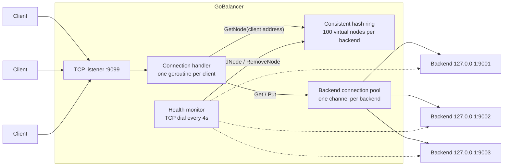
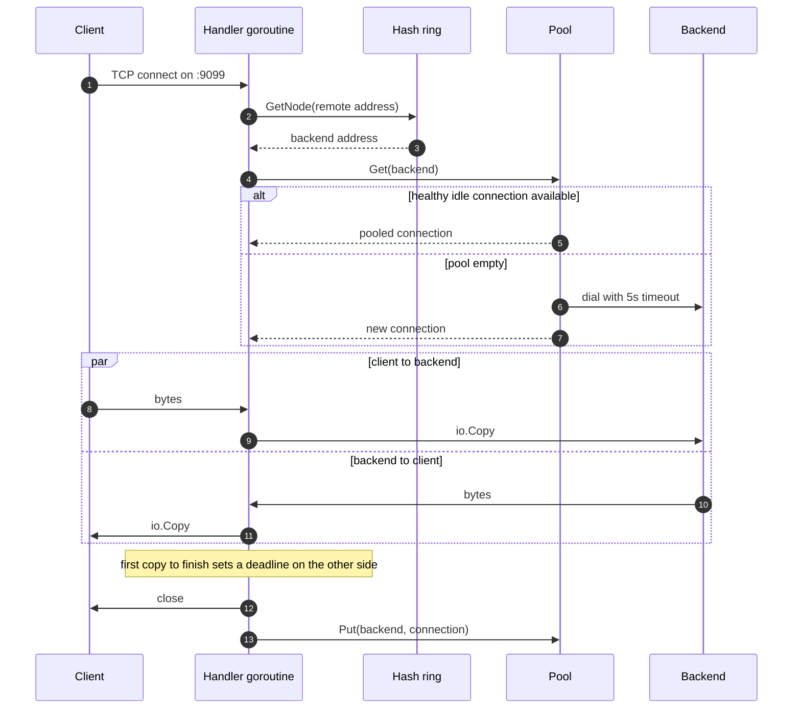
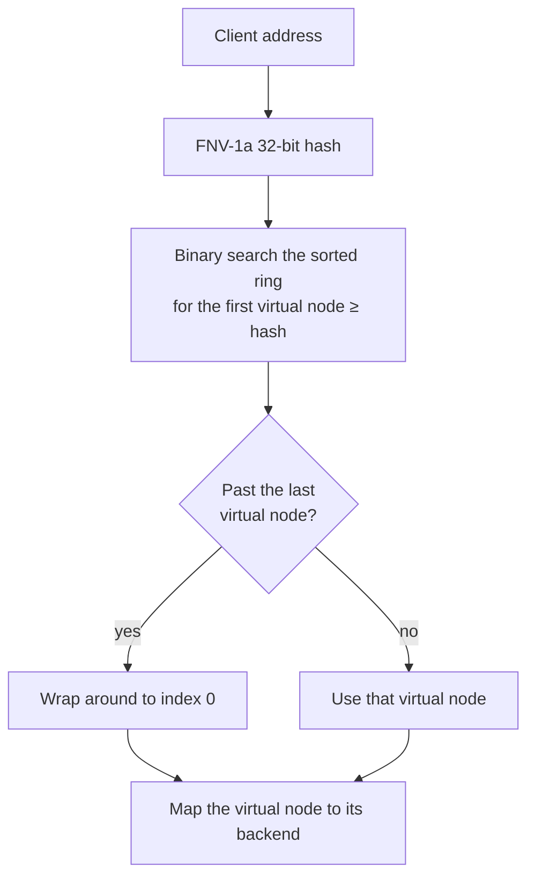
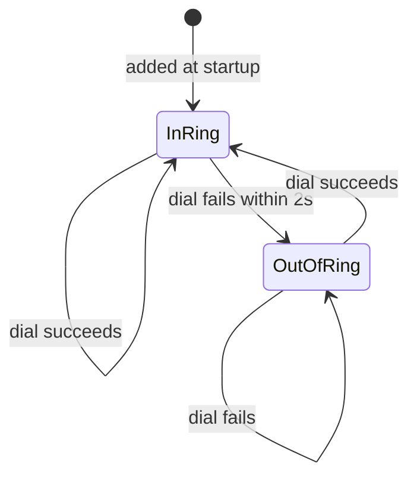
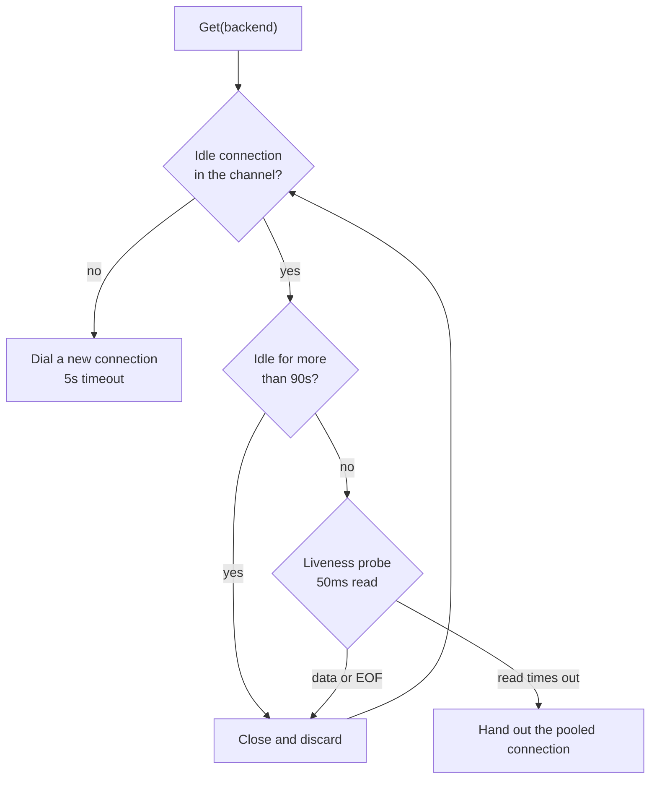
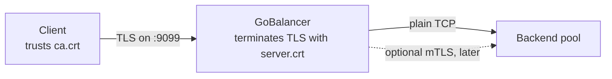

# GoBalancer


GoBalancer is a Layer 4 TCP load balancer written in Go with no external dependencies. It accepts client connections, picks a backend using a consistent hash ring, and forwards raw bytes in both directions. A background monitor health-checks every backend and keeps the ring in sync, so traffic stops going to a backend within a few seconds of it going down and resumes once it comes back.

I built it to understand what tools like HAProxy (in TCP mode) and NGINX `stream` do under the hood: how a backend gets chosen, how failures are detected, and what happens to existing clients when the set of backends changes.

## Contents

- [Architecture](#architecture)
- [Connection lifecycle](#connection-lifecycle)
- [How backend selection works](#how-backend-selection-works)
- [Health checking](#health-checking)
- [Connection pooling](#connection-pooling)
- [Graceful shutdown](#graceful-shutdown)
- [Getting started](#getting-started)
- [Configuration](#configuration)
- [Project structure](#project-structure)
- [Known limitations](#known-limitations)
- [Roadmap](#roadmap)
- [Contributing](#contributing)

## Architecture

GoBalancer is split into four small packages. The proxy handles client traffic, the ring decides where it goes, the pool manages upstream connections, and the monitor keeps the ring honest.



| Package | File | Responsibility |
|---|---|---|
| `main` | `main.go` | Builds the ring, starts the monitor and proxy, and handles `SIGINT` / `SIGTERM` |
| `ring` | `ring/ring.go` | Consistent hash ring with virtual nodes, safe for concurrent use |
| `proxy` | `proxy/tcp.go` | Accepts clients and copies bytes between client and backend |
| `proxy` | `proxy/pool.go` | Keeps idle upstream connections per backend and checks them before reuse |
| `monitor` | `monitor/monitor.go` | Periodically dials each backend and adds or removes it from the ring |

## Connection lifecycle

Every accepted connection is handled in its own goroutine. Two further goroutines copy data in each direction, and whichever finishes first sets an immediate deadline on the other connection so the opposite copy unblocks and returns.



GoBalancer never parses the payload. HTTP, Redis, a custom binary protocol: it is all just bytes to the proxy.

## How backend selection works

### Why consistent hashing

With round robin or `hash(client) % N`, adding or removing a single backend reshuffles almost every client. A consistent hash ring limits the damage: when a backend leaves, only the clients that were mapped to it move, and everyone else stays where they were.

In a three-backend setup with 200,000 simulated client addresses, removing one backend remapped 35.8% of keys, every one of which had belonged to the removed backend. No keys moved between the two surviving backends, and adding the backend back restored 100% of the original assignments.

### Virtual nodes

Each backend is placed on the ring 100 times, using the keys `address#1` through `address#100`. Spreading every backend across many points evens out the share of the hash space it owns and means a failed backend's traffic is split across all remaining backends instead of landing on a single neighbour.

### Lookup

The ring is stored as a sorted `[]uint32` of hashes plus a `map[uint32]string` from hash to backend address, guarded by a `sync.RWMutex`. Lookups take a read lock and run a binary search, so routing is `O(log n)` in the number of virtual nodes and many lookups can proceed in parallel.



Inserting a node shifts the slice, which is `O(n)`, but membership changes are rare compared to lookups, so a sorted slice is simpler and faster in practice than a balanced tree. Hash collisions between virtual nodes are skipped rather than overwritten, so one backend can never silently steal another's slot.

## Health checking

The monitor runs on a 4 second ticker. On each tick it opens a TCP connection to every configured backend with a 2 second timeout. A successful dial calls `AddNode`, a failed one calls `RemoveNode`. Both operations are idempotent, so repeating them on every tick is safe and keeps the logic simple.



Because the ring is consistent, a backend going down only affects the clients mapped to it. When it recovers, it reclaims exactly the same slice of the hash space.

## Connection pooling

Upstream connections are kept in a buffered channel per backend, capped at 500 idle connections. Returning a connection uses a non-blocking send, so when the channel is full the connection is closed instead of blocking the handler.

Before an idle connection is handed out, it goes through two checks.



The liveness probe relies on how TCP reads behave on an idle socket. A read that times out means the connection is open with nothing pending, which is what a reusable connection looks like. A read that returns data or EOF means the backend has either closed the connection or left unread bytes on it, and in both cases it is discarded.

## Graceful shutdown

On `SIGINT` or `SIGTERM`, GoBalancer:

1. Stops the health monitor.
2. Closes the listener so no new clients are accepted.
3. Waits on a `sync.WaitGroup` until every in-flight connection has finished.
4. Drains each pool channel and closes the idle upstream connections.

## Getting started

### Prerequisites

- Go 1.21 or newer (the ring uses the standard library `slices` package)
- Python 3.7+ and `curl` for the demo below. Any TCP server works as a backend.
- OpenSSL, only if you want to generate the TLS certificates (see [Roadmap](#roadmap))

### Build

```bash
git clone https://github.com/harshmittal09/GoBalancer.git
cd GoBalancer
go build -o gobalancer .
```

### Start three backends

The backend addresses are currently set in `main.go` as `127.0.0.1:9001`, `9002` and `9003`. Python's built-in HTTP server is the quickest way to stand them up, with each one serving a page that names itself:

```bash
for port in 9001 9002 9003; do
  mkdir -p /tmp/backend-$port
  echo "served by backend $port" > /tmp/backend-$port/index.html
  python3 -m http.server $port --bind 127.0.0.1 --directory /tmp/backend-$port &
done
```

### Run the balancer

In a second terminal:

```bash
./gobalancer
```

### Send traffic

```bash
for i in $(seq 10); do curl -s http://localhost:9099/; done
```

Each response tells you which backend served it:

```text
served by backend 9003
served by backend 9001
served by backend 9003
served by backend 9002
...
```

### Watch a failover

Stop one backend:

```bash
kill $(lsof -t -iTCP:9002 -sTCP:LISTEN)
```

Within about four seconds the monitor removes it from the ring and its traffic moves to the remaining two backends. Start it again and it rejoins on the next health check, taking back the same share of clients it had before.

Press `Ctrl+C` in the balancer's terminal to shut it down gracefully.

## Configuration

There is no config file or flag parsing yet. All settings are constants in the source:

| Setting | Value | Location |
|---|---|---|
| Listen address | `:9099` | `proxy/tcp.go` (`PortAddress`) |
| Backends | `127.0.0.1:9001`, `127.0.0.1:9002`, `127.0.0.1:9003` | `main.go` |
| Virtual nodes per backend | `100` | `ring/ring.go` (`VirtualNodeCount`) |
| Max idle connections per backend | `500` | `proxy/pool.go` (`maxIdlePerBackend`) |
| Max idle time before discard | `90s` | `proxy/pool.go` (`idleConnTL`) |
| Upstream dial timeout | `5s` | `proxy/pool.go` (`newConnTl`) |
| Liveness probe window | `50ms` | `proxy/pool.go` (`isAlive`) |
| Health check interval | `4s` | `monitor/monitor.go` (`timeInterval`) |
| Health check dial timeout | `2s` | `monitor/monitor.go` (`newConnTl`) |

Moving these to flags and a YAML file is on the roadmap.

## Project structure

```text
GoBalancer/
├── main.go             Wiring and signal handling
├── ring/
│   └── ring.go         Consistent hash ring with virtual nodes
├── proxy/
│   ├── tcp.go          Listener and bidirectional forwarding
│   └── pool.go         Per-backend idle connection pool
├── monitor/
│   └── monitor.go      Periodic TCP health checks
├── gen_certs.sh        Generates a local CA and a localhost server certificate
├── certs/
│   └── server.ext      X.509 extensions used when signing the server certificate
└── go.mod
```

## Known limitations

GoBalancer is a learning project and has not been hardened for production traffic. The main gaps today:

- **Client affinity.** Routing hashes the full remote address, including the source port. Every new connection from the same client gets a new port, so a client is not pinned to one backend across connections.
- **Pooled connections are shared across clients.** After a client disconnects, its upstream connection returns to the pool and can be reused by a different client. That is fine for experimenting with stateless request/response traffic, but unsafe for stateful protocols such as authenticated database sessions, or protocols where the server sends a greeting on connect.
- **Half-close.** When a client closes its write side, the upstream connection is cut straight away, so a response that is still in flight can be lost.
- **Startup and failover.** Backends are added to the ring before their first health check, and a failed upstream dial closes the client rather than trying the next node on the ring.
- **Health checks.** A single failed or successful dial is enough to change a backend's state, so a flaky backend can flap in and out of the ring.
- **Shutdown.** The shutdown waits for every open connection to finish, with no upper bound.
- **Operations.** Configuration is compiled in, and there are no automated tests yet.

## Roadmap

### TLS termination with a local CA (next up)

The groundwork for TLS is already in the repository. `gen_certs.sh` creates a private certificate authority and uses it to sign a server certificate for `localhost` and `127.0.0.1`:

```bash
./gen_certs.sh
```

| File | Purpose |
|---|---|
| `certs/ca.key` | Private key of the local CA (RSA 2048) |
| `certs/ca.crt` | Self-signed CA certificate, valid for 10 years. Add this to your trust store. |
| `certs/server.key` | Private key of the server certificate (RSA 2048) |
| `certs/server.csr` | Certificate signing request for `CN=localhost` |
| `certs/server.crt` | Server certificate signed by the CA, valid for 1 year, with SANs for `localhost` and `127.0.0.1` |
| `certs/ca.srl` | Serial number file maintained by OpenSSL |

Keys, CSRs and certificates are listed in `.gitignore` and are never committed. **The proxy does not load these files yet.** The plan is for GoBalancer to terminate TLS at the listener and forward plain TCP to the backends:



Remaining work:

- [ ] Load the key pair with `tls.LoadX509KeyPair` and wrap the listener with `tls.NewListener`
- [ ] Add flags for the certificate and key paths, keeping plain TCP as the default
- [ ] Add `extendedKeyUsage = serverAuth` to the server certificate (macOS and iOS reject TLS server certificates without it)
- [ ] Make `gen_certs.sh` reuse an existing CA instead of regenerating it on every run
- [ ] Optional mutual TLS between GoBalancer and the backends

### Other planned work

- [ ] Admin HTTP API exposing backend health, ring distribution and live connection stats
- [ ] Web dashboard built on that API
- [ ] Configuration through flags or a YAML file, plus adding and removing backends at runtime
- [ ] Hash on the client IP for real client affinity, and add a finalizer to the hash for a more even spread across backends
- [ ] One upstream connection per client, keeping pooling for a future HTTP-aware mode
- [ ] Correct half-close handling with `CloseWrite`
- [ ] Rise and fall thresholds for health checks, and failover to the next node on the ring
- [ ] Idle timeouts and a deadline on graceful shutdown
- [ ] Prometheus metrics endpoint
- [ ] Unit tests, race detector runs and GitHub Actions CI
- [ ] Dockerfile and a `docker compose` demo with three backends

## Contributing

Issues and pull requests are welcome. Before opening a PR, please run:

```bash
gofmt -l .
go vet ./...
go build -race ./...
```

## Author

Harsh Mittal ([@harshmittal09](https://github.com/harshmittal09))
